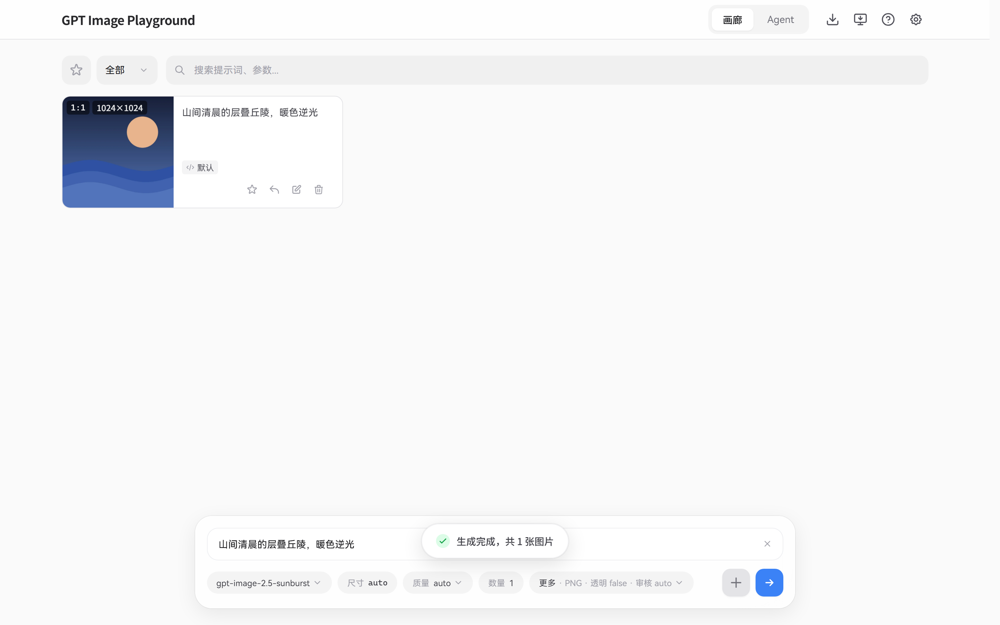
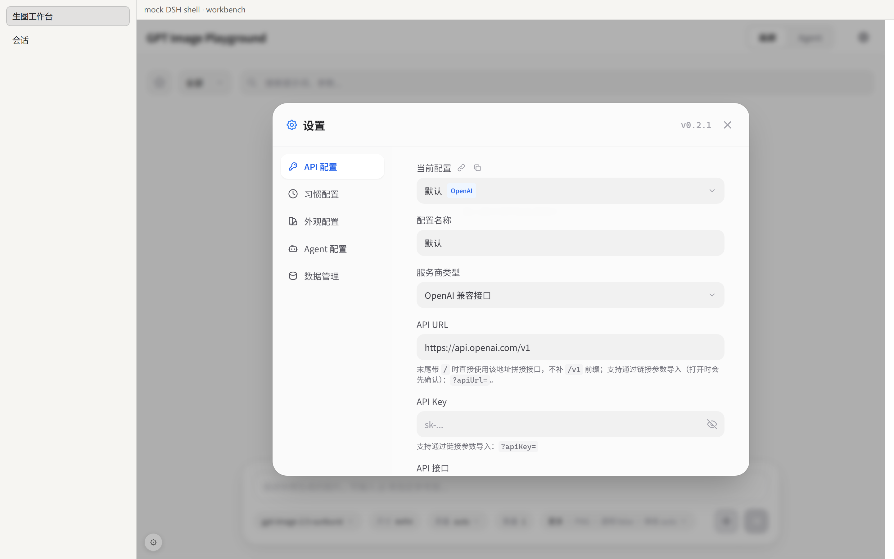

# GPT Image Playground for DeepSeek Harness

[](https://www.npmjs.com/package/dsh-gpt-image-playground)
[](LICENSE)
[](package.json)
[](https://github.com/southcul/dsh-gpt-image-playground)

把 [CookSleep/gpt_image_playground](https://github.com/CookSleep/gpt_image_playground) 的**原版工作台**装进 [DeepSeek Harness](https://github.com/deepseek-ai)（DSH）：左栏多一个「生图工作台」，点开就是完整的画廊 / Agent 双模式、参考图与遮罩编辑、多供应商、收藏夹、历史管理。

界面与功能来自上游官方构建（v0.8.3，原样 vendor），插件自己只负责**同源托管**和**可选的 API 代理**。



## 安装

### 用 npm 包名（推荐）

在 DSH 里打开 **插件 → 安装**，填：

```
dsh-gpt-image-playground
```

装完在插件列表里启用，刷新页面（Ctrl+R），左栏出现「相框」图标。

命令行等价：

```bash
dsh plugin --profile desktop add dsh-gpt-image-playground
```

### 从 Release 压缩包

下载 [最新 Release](https://github.com/southcul/dsh-gpt-image-playground/releases/latest) 里的 `gpt-image-playground-<版本>.zip`，解压后二选一：

- DSH 插件页 → 安装 → 填解压目录的**绝对路径**（推荐）
- 或右键 `install.ps1` → 使用 PowerShell 运行（内部是 `node install.mjs --copy`）

### 从仓库源码

```bash
git clone https://github.com/southcul/dsh-gpt-image-playground
```

DSH → 插件 → 安装 → 填克隆目录的绝对路径。

### 插件市场「发现」页

目录收录后可搜到；收录流程见 [docs/awesome-submission.md](docs/awesome-submission.md)。

### 开发用链接模式

```bash
node install.mjs             # junction 到桌面 profile，改代码即热加载
node install.mjs --uninstall # 卸载
```

## 第一次使用

1. 打开工作台 → 右上角齿轮 → **API 配置**，填 API URL 与 Key（存在本机浏览器存储，不上传）。
2. 若提示「接口不支持浏览器跨域请求」：点工作台**左下角 ⚙**（iframe 外的小按钮），填真实 API 地址并保存；再把面板里显示的代理地址复制到应用的「API URL」。

代理地址形如 `http://127.0.0.1:13807/plugins/dsh-gpt-image-playground/proxy`，请求由 DSH 主机转发，`Authorization` 与 multipart 图片体原样透传。

## 功能

完整继承上游：

- 画廊 / Agent 双模式；批量生成、迭代、多提示词提交、流式预览
- 参考图（最多 16 张）、遮罩编辑器、画板标注（画笔/文字/图形/像素橡皮擦）、评论定位
- 多 API 配置与多供应商（OpenAI 兼容 Images/Responses、sub2api 异步、fal.ai、自定义 HTTP 供应商）
- 1K/2K/4K 尺寸预设与规整、真实参数与改写后提示词对比
- 收藏夹、失败重试、框选/侧滑多选、大图预览、ZIP 备份
- 透明背景（原生 / 本地后处理）、Codex CLI 兼容、提示词防改写、外观与习惯配置

## 与上游的差异

界面裁剪与信息改写都在 iframe 内用注入的方式完成，**不改上游构建产物**：

- 隐藏右上角三个按钮：安装为应用 / 下载客户端 / 操作指南
- 隐藏设置页的「关于」标签（上游的更新检查与赞助入口；第三方许可仍随包提供，见 `THIRD-PARTY-NOTICES.md`）
- 设置页右上角的版本徽标改为**本插件版本**（不带 tooltip、不显示上游版本）
- 关闭上游公告卡（`vendor-app/announcements.json` 为 `[]`）
- 工作台运行在常驻 iframe 中，因此 DSH 的窗口级快捷键不穿透到应用内部



## 技术要点：为什么 iframe 常驻在 `shell.overlay`

DSH 的 `main` 槽是 keyed 槽，只渲染当前选中的那一项：切到别的面板会卸载工作台。iframe 若挂在这个面板里，切换面板就会销毁文档，正在跑的生成请求随之中断（表现为「报错但没有原因」）。

所以 `main` 里只放占位盒登记矩形，iframe 住在常驻的 `shell.overlay` 条目里；切走时只是 `display:none`，请求继续跑完，回来还是同一个文档。

## 结构

```
lib/index.js            宿主半侧：静态托管、同源代理、设置读写、精简原生 API
lib/client.js           浏览器半侧：槽位注册、常驻 surface、代理面板、界面裁剪
vendor-app/             上游构建产物（index.html / assets）
cordis.patch.yml        组合包 patch（insert 自身一条 Loader 行）
install.mjs             安装/卸载（--link 开发、--copy 分发）
install.ps1             Windows 一键安装（包装 install.mjs --copy）
publish.ps1             npm 发布（用 DSH 自带的 pnpm）
test-server.mjs         宿主半侧自测（原生 API + 静态托管 + 代理透传）
client-test.mjs         浏览器半侧自测（槽位注册 + 样式）
tools/vendor-dist.mjs   重新抓取上游构建
tools/pack.mjs          打 zip / tgz（内部调用 tools/pack.py）
tools/check-package.mjs 发布前校验（manifest / files / 许可证 / 占位符）
tools/test-pack.mjs     分发包回归：解压安装、卸载、复制后仍可挂载
tools/test-npm-tarball.mjs  npm tarball 安装回归
tools/mount-check.mjs   对任意目录做一次挂载检查
tools/npm-verify.mjs    查注册表：latest、版本、tarball 可达性
tools/npm-info.mjs      查任意包名的归属与版本
tools/net-check.mjs     GitHub / npm 连通性自检
tools/set-repo.mjs      一键写入 repository / homepage / bugs
tools/fetch-fonts.mjs   可选：下载上游内置字体（约 23 MB）
docs/first-publish.md   第一次发布的逐步教程
docs/awesome-submission.md  插件市场收录条目
```

## 开发

```bash
node test-server.mjs        # 宿主半侧
node client-test.mjs        # 浏览器半侧
node tools/pack.mjs         # 重新打 dist/（zip + tgz）
node tools/test-pack.mjs    # 分发包回归
node preview/serve.mjs --port 4518
node tools/test-switch.mjs  # 切换面板不中断生成的回归测试
```

更新上游：

```bash
node tools/vendor-dist.mjs  # 从 GitHub Pages 抓官方构建
node tools/pack.mjs
```

内置字体默认**不随包分发**（HarmonyOS Sans SC 三个字重 + Maple Mono，约 23 MB）：界面会回退到系统字体，显示正常。需要离线内置字体时：

```bash
node tools/fetch-fonts.mjs  # 下载到 vendor-app/assets，然后重新打包
```

## 发布

```bash
node tools/check-package.mjs --strict          # 校验
powershell -ExecutionPolicy Bypass -File .\publish.ps1   # npm
git tag v0.2.1 && git push origin v0.2.1       # GitHub Release（Actions 打包含附件）
```

第一次发布请对照 [docs/first-publish.md](docs/first-publish.md)。

## 许可与致谢

- 本插件：MIT，见 [LICENSE](LICENSE)
- `vendor-app/` 是 GPT Image Playground 的官方构建，MIT，版权归 **CookSleep**，详见 [THIRD-PARTY-NOTICES.md](THIRD-PARTY-NOTICES.md)
- 上游项目：https://github.com/CookSleep/gpt_image_playground
